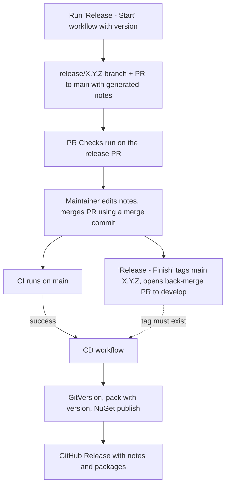

# Release Automation Plan

Plan for automating the Lewee release process described in [#636](https://github.com/TheMagnificent11/lewee/issues/636).

This is a process/CI plan, not a software change, so it lives in `docs/` rather than `openspec/`.
Once the plan is implemented, this document should be turned into (or replaced by) a release runbook.

## Current State

| Area | Today |
| ---- | ----- |
| Branching | Git Flow. `develop` is the default branch, feature and bug PRs target `develop`, `main` only receives releases |
| Release start | `git flow release start <SemVer>` on the maintainer's laptop, then the branch is pushed |
| Release finish | `git flow release finish <SemVer>` on the maintainer's laptop. Release notes are written by hand from the commit history. Git Flow creates the tag and merges to `main` and `develop` |
| Versioning | [GitVersion](https://gitversion.net/) (`GitVersion.yml`) run inside `build-and-test.yml`. On a tagged commit it resolves to the tag |
| Build and publish | `ci.yml` calls `build-and-test.yml` for `develop` and `main`. That workflow also runs GitVersion, `dotnet pack` and, only on `main`, NuGet trusted-publishing login and `dotnet nuget push` |
| GitHub Release | Created manually from the tag, with the same notes |
| DLL versions | Always `1.0.0.0`, because only `/p:PackageVersion` is passed to `dotnet pack` |

## Goals

1. Starting and finishing a release is a button press in GitHub (no laptop, no `git flow` CLI).
2. Release notes are generated from merged PRs and can be edited before the release is finalised.
3. Publishing to NuGet and creating the GitHub Release happen in a dedicated CD workflow that runs only after CI succeeds on `main`.
4. `build-and-test.yml` becomes a pure build and test workflow (no GitVersion, NuGet login or publish).
5. DLLs in the NuGet packages carry the package version, without committing a version to source control.

Non-goals: changing the branching model, changing how GitVersion computes versions, hotfix automation (see [Future Work](#future-work)).

## Findings That Shape the Design

1. **DLL versioning (verified).** Packing `src/Lewee.Common` with `/p:PackageVersion=2.3.4` produces a DLL with file/assembly version `1.0.0.0`.
   Packing with `/p:Version=2.3.4-beta.1` produces file/assembly version `2.3.4.0` and informational version `2.3.4-beta.1+<commit sha>`, and the package version is `2.3.4-beta.1`.
   `dotnet pack` rebuilds by default, so passing `/p:Version` to the pack step is enough. Nothing needs to be committed.
2. **`GITHUB_TOKEN` events do not trigger workflows.** Branches, tags or PRs created by a workflow using `GITHUB_TOKEN` do not start other workflows (for example `pr-checks.yml` on an automated release PR).
   Automation that creates the release branch/PR needs a GitHub App installation token (preferred) or a fine-grained PAT.
3. **NuGet trusted publishing is bound to a workflow file.** The trusted publishing policy for the `lewee` packages on nuget.org references the workflow file name (currently `ci.yml`).
   Moving the publish step to a new workflow file requires adding a policy for the new file before cutover.
4. **GitVersion needs the tag.** `GitVersion.yml` uses `mode: ContinuousDelivery` with `increment: None`, so a `main` commit without a SemVer tag does not produce a meaningful release version.
   The CD workflow must refuse to publish untagged commits and must tolerate the tag arriving a few seconds after the `main` push.
5. **Release PRs must be merged with a merge commit.** Squash or rebase merges break Git Flow ancestry (the release is no longer reachable from `develop`), so this repository setting/policy matters for the automated flow.

## Target Flow

## Proposed Changes

### Phase 1 - DLL Versioning

Smallest and independently shippable.

- In the `Pack` step, replace `/p:PackageVersion=<fullSemVer>` with `/p:Version=<semVer>`.
  `PackageVersion` then defaults to `Version`, and the SDK also sets `AssemblyVersion`, `FileVersion` and `InformationalVersion`.
- Decide whether `AssemblyVersion` should follow every release or only the major version.
  Default proposal: use the SDK default (`Major.Minor.Patch.0`) and revisit if strong-name/binding issues appear. To pin it, add `/p:AssemblyVersion=<major>.0.0.0` using the GitVersion `major` output.
- Acceptance: after a release, a DLL extracted from a published `.nupkg` reports the package version (for example via `Get-Item <dll> | % VersionInfo`), and the NuGet package version is unchanged.

### Phase 2 - Separate CD Workflow

Create `.github/workflows/cd.yml`.

- Trigger: `workflow_run` of `Continuous Integration`, `types: [completed]`, `branches: [main]`.
  Run only when `conclusion == 'success'` and the CI event was `push` or `workflow_dispatch`.
- Permissions: `contents: write` (GitHub Release, Phase 3) and `id-token: write` (NuGet trusted publishing).
- Checkout `github.event.workflow_run.head_sha` with `fetch-depth: 0` (a `workflow_run` job otherwise checks out the default branch, `develop`).
- Steps: guard that `head_sha` has a SemVer tag (retry for a few minutes, then skip with a notice), GitVersion setup and execute, `dotnet pack --configuration Release /p:Version=...`, NuGet login, `dotnet nuget push ... --skip-duplicate`.
  No build/test steps: CI has already validated the commit.
- `concurrency` group keyed on the tag so a re-run cannot publish twice. `--skip-duplicate` keeps the workflow idempotent.
- Optional: run the publish job in a `nuget` GitHub environment with a required reviewer as a manual gate.
- Note: `workflow_run` workflows always run from the default branch (`develop`), so `cd.yml` must be merged to `develop` before it is effective. It is intentionally not triggered by `develop` builds.

Changes to existing files:

- `build-and-test.yml`: remove the GitVersion setup/execute, NuGet login and publish steps and the `github.ref == 'refs/heads/main'` conditions.
  Keep a version-less `dotnet pack --no-build` as a packaging smoke test, since packaging errors would otherwise only surface at release time.
- `ci.yml`: drop `id-token: write`, which is no longer needed there.

Cutover order (avoids a window where nothing can publish):

1. Add a NuGet trusted publishing policy for `cd.yml` (keep the `ci.yml` one).
2. Merge `cd.yml` and the `build-and-test.yml`/`ci.yml` changes together.
3. Perform the next release and confirm publishing from `cd.yml`.
4. Remove the old `ci.yml` policy on nuget.org.

### Phase 3 - GitHub Release

Add a step to `cd.yml`, after a successful NuGet push (so a Release implies the packages exist, and a failed publish can be re-run):

- `gh release create <tag> --verify-tag --notes-file <notes> ./output/*.nupkg ./output/*.snupkg`.
  Mark it as a pre-release when the version has a SemVer suffix.
- Release notes source, in order of preference: the annotated tag message (set by Phase 4 from the edited release PR body), otherwise `--generate-notes`.
- Add `.github/release.yml` so generated notes are grouped by PR labels (for example `bug`, `enhancement`, `documentation`, `devops`, `dependencies`). Align the categories with the labels already used in the repository.
- Make it idempotent: if the Release already exists, skip creation rather than fail.

### Phase 4 - Branching Automation

Two options were considered.

| Option | Pros | Cons |
| ------ | ---- | ---- |
| A. [Gitflow workflow action](https://github.com/marketplace/actions/gitflow-workflow-action) (`hoangvvo/gitflow-workflow-action`) | Little code. Creates `release/X.Y.Z`, a release PR with a "What's changed" list, and on merge a GitHub Release and a merge back to `develop` | Third-party action with write access. It creates the GitHub Release itself (overlaps with Phase 3, and the Release exists before NuGet publishing). The tag is created after the merge, so CD must wait for it |
| B. In-repo workflows using `git`/`gh` | Full control of tag creation and notes. No new third-party dependency. Fits the CD design | More YAML to own and test |

Recommendation: **Option B**, because the tag must be created by the release process for GitVersion to work, and CD already owns the GitHub Release.
If Option A is preferred, pin it to a commit SHA and use it only to create the release branch/PR; handle tag creation and merge-back in an in-repo finish workflow. Do not use its post-release path, which creates the GitHub Release before NuGet publishing. Alternatively, require a fork that separates release creation from merge-back.

Option B design:

- `release-start.yml` (`workflow_dispatch`, input `version`):
  - Validate the version is SemVer, greater than the latest tag, and that `release/<version>` and the tag do not already exist.
  - Create `release/<version>` from `develop` and open a PR to `main`. The PR body is pre-filled with notes from `gh api repos/{owner}/{repo}/releases/generate-notes` so the maintainer can edit them.
  - Use a GitHub App token so `pr-checks.yml` runs on the PR (Finding 2).
- `release-finish.yml` (`pull_request: closed`, merged, head ref `release/*`, base `main`):
  - Create an annotated tag `<version>` (version parsed from the branch name, message from the PR body) on the merge commit and push it.
  - Open a back-merge PR from `main` to `develop` (auto-merge if it has no conflicts, otherwise left for the maintainer).
  - Delete the release branch (or enable "Automatically delete head branches").
- Repository settings: allow merge commits for PRs targeting `main`, protect `main` (require PR and checks), and restrict who may run the release workflows.

Manual `git flow release finish` keeps working throughout: it pushes `main` and the tag, which flows through CI and CD unchanged. The manual process is the fallback until Phase 4 is proven.

### Phase 5 - Cleanup and Documentation

- Update `.github/instructions/` (for example the CI/CD notes and repository structure) to describe the new workflows.
- Replace this plan with a short `docs/releasing.md` runbook: how to start a release, edit notes, merge, verify publishing, recover from failures.

## Decisions Needed From the Repository Owner

1. GitHub App versus fine-grained PAT for automation that must trigger workflows.
2. Option A or Option B for Phase 4.
3. Whether `AssemblyVersion` should track every release or only the major version.
4. Whether the NuGet publish job should require manual approval through a GitHub environment.
5. Tag format: keep the bare SemVer tag used by Git Flow today (for example `1.2.3`), or add a `v` prefix.
6. Whether to attach the `.nupkg`/`.snupkg` files to the GitHub Release.

## Risks and Mitigations

| Risk | Mitigation |
| ---- | ---------- |
| Publishing an untagged `main` commit | CD guard that requires a SemVer tag on the commit |
| Tag not yet pushed when CD starts | CD polls for the tag for a bounded time, then skips with a clear notice |
| Double publish on re-run | `--skip-duplicate`, a `concurrency` group and an idempotent Release step |
| Publishing breaks after the move to `cd.yml` | Add the new NuGet policy before cutover, keep the old one until a release succeeds |
| Automated PRs/tags do not trigger CI | Use a GitHub App token (Finding 2) |
| Squash-merge of a release PR breaks Git Flow history | Merge-commit-only for PRs targeting `main` |
| CD changes cannot be tested before a release | Test with a pre-release version (for example `1.0.0-beta.1`) and `--skip-duplicate`/a test feed first |

## Testing Strategy

- Phase 1: pack locally, inspect DLL file versions (already verified with `Lewee.Common`).
- Phases 2 and 3: run CD on a throwaway pre-release tag; confirm the package, DLL versions and GitHub Release.
- Phase 4: run the start/finish workflows with a pre-release version against the real repository, then delete the test tag, release, and branches (and unlist the test package on nuget.org).

## Future Work

- Hotfix automation (`hotfix/*` from `main`, merged to `main` and `develop`).
- Notifications (for example Slack) on release success or failure.
